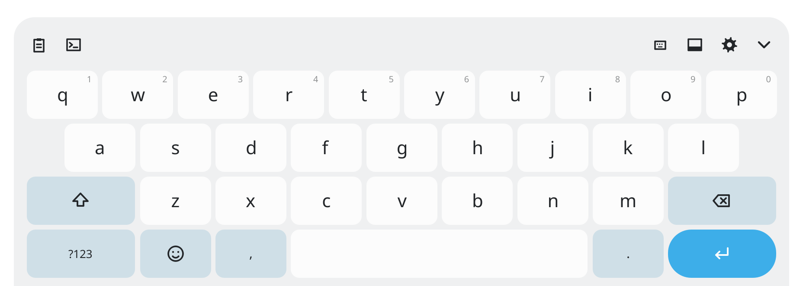
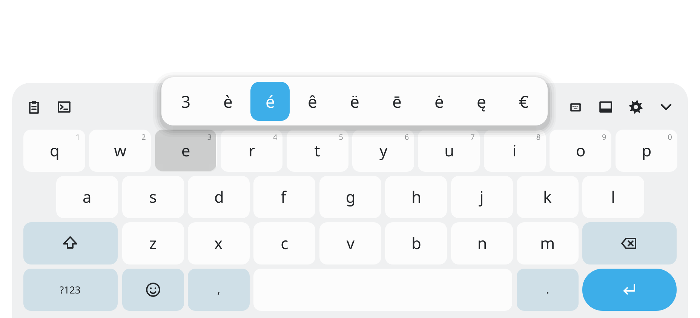
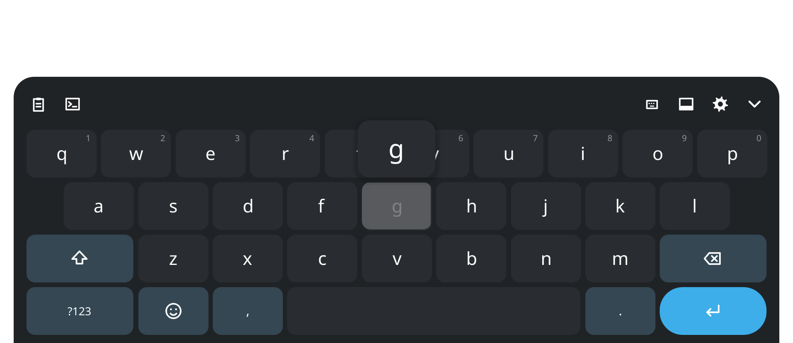
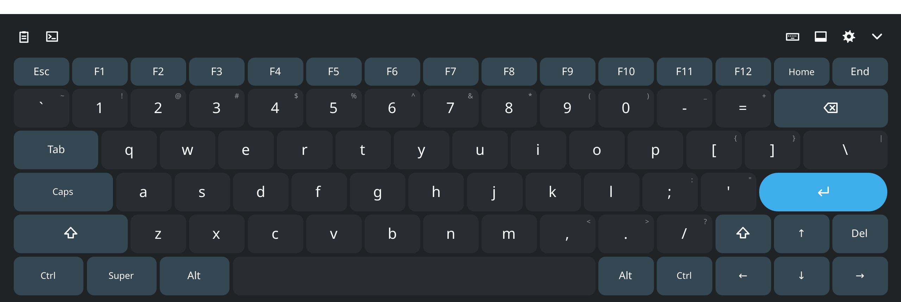
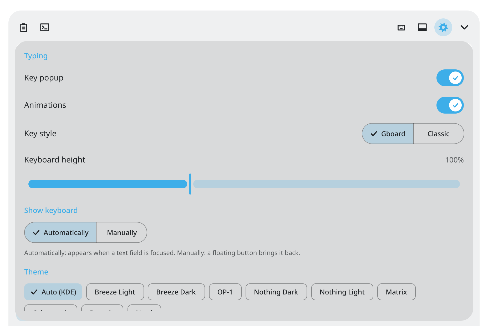

# Huskie-board

**A Gboard-style touch keyboard for KDE Plasma 6 on Wayland.**
Built for Linux tablets and convertibles: it appears when you tap a text field, works on the
lock screen and the login screen, and follows your KDE colour scheme.

<picture>
  <source media="(prefers-color-scheme: dark)" srcset="docs/screenshots/keyboard-dark.png">
  
</picture>

---

## Features

- **Shows up when you need it.** Appears when a text field is focused and hides when it loses
  focus, like KDE's own keyboard. Hide it with <kbd>⌄</kbd>; tap the field again to bring it back.
- **Lock screen and login screen.** Works on the Plasma lock screen and on the Plasma Login
  Manager greeter, so you can sign in without a hardware keyboard.
- **Types into everything that supports Wayland text input.** Text, accents and emoji go straight
  into the focused field through KWin's input-method protocol: no clipboard tricks.
- **Phone-style typing**
  - Key popout above your finger
  - Hold a letter for accents (`e` → 3 è é ê ë ē ė ę €), the top row offers its number first,
    hold <kbd>.</kbd> for punctuation. Slide to pick, release to type.
  - Tap <kbd>⇧</kbd> for one capital, double-tap for caps lock
- **Material look.** Ripple feedback, tonal keys tinted with your accent colour, rounded popups
  with soft shadows. A classic outlined style is available too.
- **Matches your KDE theme** by default (light or dark, accent colour), with Breeze, Nord,
  Dracula, Nothing, OP-1, Matrix and Cyberpunk themes available.
- **Three sizes**
  - **Normal**: phone layout
  - **Extended**: full PC layout with Esc, F1–F12, number row, punctuation, Ctrl/Super/Alt and
    arrow keys
  - **One-handed**: compact width (sits at the side when floating)
- **Docked or floating.** Docked sits flush at the bottom centre; floating can be dragged anywhere
  (but never off-screen). Neither resizes your apps.
- **Adjustable height** (70–150 %), clipboard history (Klipper), emoji and a terminal shortcut bar.

## Screenshots

| Hold for accents | Key popout (dark) |
|---|---|
|  |  |

**Extended layout**



**Settings**



---

## Installation

### Arch Linux (and derivatives, incl. aarch64)

```bash
git clone https://github.com/leenknegt-eu/huskie-board.git
cd huskie-board/packaging/arch
makepkg -si
```

The package replaces the old `tastiera-git` package if you had it installed.

### Other distributions

Requirements: Qt 6 (Core, Gui, Quick, Qml, DBus, WaylandClient incl. private headers), KDE
Frameworks 6 (CoreAddons, I18n), LayerShellQt, wayland-protocols, extra-cmake-modules.

```bash
cmake -B build -DCMAKE_BUILD_TYPE=Release -DCMAKE_INSTALL_PREFIX=/usr
cmake --build build
sudo cmake --install build
```

## Setup

1. Open **System Settings → Keyboard → Virtual Keyboard** and select **Huskie-board**.
2. Log out and back in.

That's it. KWin starts Huskie-board itself; you don't need to launch it.

**Login screen:** the package installs a systemd drop-in
(`/usr/lib/systemd/user/plasma-login-kwin_wayland.service.d/huskie-board.conf`) so the Plasma
Login Manager greeter uses Huskie-board instead of the built-in `plasma-keyboard`. Reboot once
after installing. To skip it, build with `-DHUSKIE_LOGIN_SCREEN=OFF`.

## Using it

The toolbar above the keys, from left to right:

| Icon | Action |
|---|---|
| Clipboard | Klipper clipboard history (tap again to return) |
| Terminal | Shortcut bar with `$ \| ~ / - _ sudo grep ls -la cd clear` |
| Keyboard size | Cycle Normal → Extended → One-handed |
| Screen with bar | Toggle docked / floating |
| Gear | Settings |
| <kbd>⌄</kbd> | Hide the keyboard |

In floating mode, drag the `:::` grip to move the keyboard.

In the **Extended** layout, <kbd>Ctrl</kbd>, <kbd>Alt</kbd>, <kbd>Super</kbd> and <kbd>Shift</kbd>
latch for the next key: tap <kbd>Ctrl</kbd>, then <kbd>C</kbd>. Tap a modifier again to release it.

### Settings

| Setting | Options |
|---|---|
| Key popup | On / off |
| Animations | On / off (ripples, popups, slide in/out) |
| Key style | Gboard (flat) / Classic (outlined) |
| Keyboard height | 70 – 150 % |
| Show keyboard | Automatically (text fields) / Manually (floating button) |
| Theme | Auto (KDE) and 9 fixed themes |

Settings are stored in `~/.config/KDE/huskie-board.conf`. Settings from the old `tastiera` name
are migrated automatically.

## How it works

- **Typing** uses `zwp_input_method_v1`, the protocol KWin offers only to the keyboard process it
  launches. Text is committed directly; special keys and shortcuts are sent as keysyms.
- **Showing and hiding** follows KWin's activate/deactivate events for focused text fields.
  Hiding is reported back to KWin, so tapping the still-focused field re-activates the keyboard.
- **On screen**, the keyboard is a layer-shell overlay, so it never resizes your apps. While the
  screen is locked it switches to an input-panel surface (`zwp_input_panel_surface_v1`), the only
  keyboard surface KWin shows over the lock screen.
- **Fallback:** if no text field is active, keys are sent through `/dev/uinput`.

## Known limitations

- **Global shortcuts:** shortcuts sent from the keyboard (e.g. <kbd>Super</kbd>+key,
  <kbd>Alt</kbd>+<kbd>Tab</kbd>) reach the focused app, not KWin's global shortcuts.
- **Apps without Wayland text input** (some terminals) don't trigger automatic showing. Use
  manual mode, or Plasma's virtual-keyboard toggle.
- **SDDM** isn't covered by the login-screen drop-in, only Plasma Login Manager. The drop-in
  copies the greeter's KWin arguments, so a future plasma-login-manager update may require
  updating it.

## Development

```bash
cmake -B build -DCMAKE_BUILD_TYPE=Debug && cmake --build build
```

The keyboard needs a Wayland session; for automatic mode it has to be launched by KWin as the
input method. `deploy_to_tablet.sh` syncs, builds and restarts it on a tablet over SSH (set
`TABLET_HOST` first). See [CHANGELOG.md](CHANGELOG.md) for the history of changes.

## Credits & license

Huskie-board started as a fork of [tastiera](https://github.com/andreadelsarto/tastiera) by
Andrea Del Sarto, which is released under the GPL-3.0. As a derivative work, Huskie-board is
licensed under the **GNU General Public License v3.0** as well; see [LICENSE](LICENSE).
